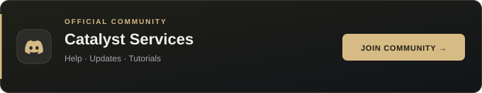

# Calyst Strap

**Your Roblox. Your workspace.**

Windows launcher and client-management tools by **Catalyst Services**.

**[Download for Windows](https://github.com/calystdevs/calyst-strap-releases/releases/latest/download/Calyst-Strap-Setup.exe)** &nbsp; / &nbsp; **[Join Discord](https://discord.gg/tYp786QfMX)** &nbsp; / &nbsp; **[Watch tutorials](https://www.youtube.com/@calyst-devs)**

If Calyst helps your workflow, consider giving the project a star.

> [!CAUTION]
> **Use official download links.** Calyst Strap installers are published through this repository's **[GitHub Releases](https://github.com/calystdevs/calyst-strap-releases/releases)**. Our official community is **[Discord](https://discord.gg/tYp786QfMX)** and our tutorials are on **[YouTube](https://www.youtube.com/@calyst-devs)**. Check the source before downloading files from other locations.

Calyst Strap brings Roblox launch controls, accounts, Fast Flags, customisation and window tools into one Windows workspace.

## Latest release

**Calyst Strap v2.0.9 is available.** [Download the latest Windows setup](https://github.com/calystdevs/calyst-strap-releases/releases/latest/download/Calyst-Strap-Setup.exe) or read the [full changelog](https://github.com/calystdevs/calyst-strap-releases/releases/latest).

Upgrading from the previous download repository? Install this replacement once. Existing per-user accounts and preferences are retained, and future updates use this official repository.

## Features

| Feature | What you can do |
| --- | --- |
| **Launch & accounts** | Organise accounts and control how Roblox starts. |
| **Fast Flags** | Import presets, review compatibility and apply supported settings. |
| **Skins & assets** | Manage optional skin packs, fonts, cursors and client customisation. |
| **Window tools** | Arrange clients with Auto Grid and custom window sizes. |
| **Auto Rejoin** | Reconnect after eligible disconnects or crashes, with server hops and full servers excluded. |
| **Personalisation** | Choose themes, accents and interface scale to suit your workspace. |

## Get started

1. Open **[Releases](https://github.com/calystdevs/calyst-strap-releases/releases)** and choose a published Calyst Strap installer.
2. Close the previous Calyst instance and Roblox before installing or upgrading.
3. Follow setup, then open Calyst and configure the features you want to use.
4. Follow the **[YouTube tutorials](https://www.youtube.com/@calyst-devs)** for a walkthrough.

<strong>About Fast Flags and performance</strong>

Flag compatibility and visual effects depend on the running Roblox build and experience. Calyst reports the settings it can resolve; an FPS increase is not guaranteed.

<strong>Calyst Strap and Calyst Client</strong>

This repository is dedicated to Calyst Strap. Calyst Client is a separate application and will use its own repository, downloads and release history.

## Community & support

Use **[Discord](https://discord.gg/tYp786QfMX)** for setup help and community support. For a reproducible app problem, open a **[bug report](https://github.com/calystdevs/calyst-strap-releases/issues/new/choose)**.

Include the Calyst version, Windows version, steps to reproduce and relevant Console text. Remove license keys, cookies, authentication tokens and personal information before posting logs or screenshots.

---

Built by <strong>Catalyst Services</strong> · Independent software · Not affiliated with or endorsed by Roblox Corporation.

